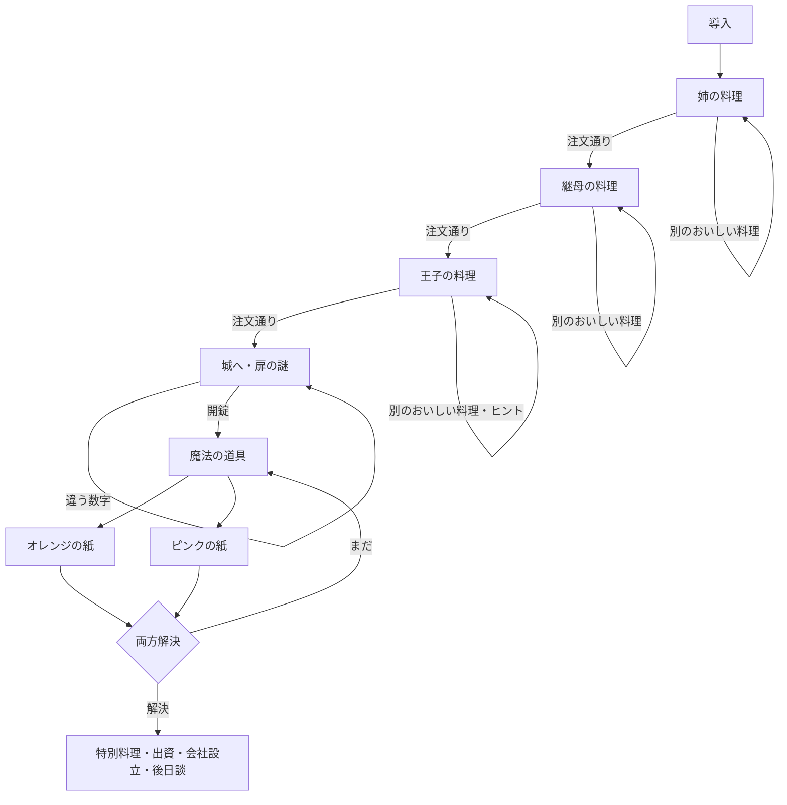

# シンデレラの料理：全編構成と制作範囲の相談案

作成日：2026-10-31（日本時間）。現時点の提案であり、収録範囲の決定ではありません。

## ソース取得後の追記

GitHubの `takatama/cinderellas-cooking` に追加された実装・画像を、2026-10-31に取得できた。現在は既存の絵で導入を4段階に接続し、材料ペアの提示順・左右のランダム化と、順不同の料理判定を実装。以下の調査時点の接続失敗記録は経緯として残す。追加の導入画像・本を隠す動きは未制作。

## 調査の根拠と限界

- 前チャット「Check Google Drive folder access」の最終ターンから引き継ぎ資料を読了。同ターンに残る文書本文を `HANDOFF.md` に復元した。元のGitファイルを取得したものではない。
- [保存コード index.js](https://drive.google.com/file/d/1-qXFxGSrqkSvoC8IUcz23ZWp1NF6OSla/view) を取得し、`original-index.js` に保存。実行中の定義はGoogle Assistant英語版、日本語問題定義はコメント内。日本語の料理判定はコードにも残っている。
- [日英シナリオ・料理表](https://docs.google.com/spreadsheets/d/1IrIVGGT9AJoqXbJpDSO8RFEZycbEtHQ8CkgEmM31vYA/edit) を読み、`scenario-tables.txt` に保存。台詞表には英語版の料理を日本語で記述した箇所や検討メモもある。日本語Alexa版の完全な最終台本とは扱わない。
- [初期企画メモ](https://docs.google.com/document/d/1vo5mZVhEqHrhu8nl8ZbvIH6ArFKFsmPPRO4SLB0qoDM/edit) も確認。掃除・買い物・舞踏会・宇宙人等の案は採用済み仕様に含めない。
- [現在のデモ](https://cinderella-first-dish.halvedfable.chatgpt.site/) のSites登録と配信済みバージョン8（`c9d9fead7f75f91315ad9d4aa494cfbb77550e95`）を確認。今回、Git取得はプロキシ接続失敗、保存アーカイブの取得も認可／解決エラー。デモ実ファイル・表示の再検証は未完了。既存素材と実装済み機能については引き継ぎ記録に基づく。

## 2026-10-31のユーザー確認による更新

- 制作の次の焦点は導入。料理の本を隠され、いじわるされているシンデレラを「助けてあげたい」と思える流れを先に整える。具体案は `INTRO_STORYBOARD.md`。
- スープ問題は「こんしそめお」が正しく、文字の読みの末尾は「おしまいの、お」。ユーザーがAlexa側を修正・再Deploy済みと報告。下記の保存コードは修正前の資料として保持し、現行Alexaと混同しない。
- 英語版はAlexaでは公開していないようだ、とのユーザー確認。英語資料の存在からAlexa英語版の公開を推定しない。
- 「パンのような名前」の答えはパンプキン。かぼちゃも同義語として正解とし、受け付けた後に「パンから始まるパンプキン」だと伝えて、なぞなぞの意味を回収する。
- 天然な言動は原作では最初のカレーの場面のみ。他の料理に一律追加しない。吹き出しは台詞や補足があるときだけ表示し、空欄や汎用文で埋めない。
- 二択の提示位置は原作でもランダムだったとユーザーが再プレイで確認。ウェブ版では二択の左右と3組の出題順の両方をランダム化する方針。出題開始時に順序を確定し、表示更新や設定開閉では動かさない。台詞・地の文は画面上の何問目かではなく食材ペアに紐付ける。
- 全周回の収録範囲は引き続き相談中。導入を先に作ることを、全編案A／Bの確定とは扱わない。

## 守る制作方針

シンデレラは料理上手で天然。食材が違っても別のおいしい料理になる。プレイヤーを責めず、その場で作り直せる。姉・継母はつんとしていてもおいしさを隠せない。台詞と地の文、ひと言のない場面を原作どおり使い分ける。絵・表情・配置で伝え、重複する説明や補助ラベルは足さない。音なし・キーボード・動きを減らす設定でも進行できるようにする。

図鑑・好感度・経営ゲーム・自由な食材合成・時間制限の追加は未採用。結末に会社設立があることと、経営を遊ばせることは別。

## 全体の場面と分岐

制作上の場面区分。下記の10区分が原作の公式な章数という意味ではない。

| ID | 場面と役割 | 操作・分岐 | 必要な画面・素材 | 現状 |
| --- | --- | --- | --- | --- |
| S00 | はじまり。姉がレシピ本を隠した事情と助ける依頼 | はじめる／中断。原作には再訪時の続きから／最初からもある | 台所、シンデレラ・姉、導入文。再開UI | 導入はデモにあり。永続保存なし |
| S01 | 姉の料理 | 二択を3回→調理→試食。注文通りならS02、違えば別料理を味わい再挑戦。断ると中断 | 食材、完成料理、調理器具、姉の3表情、シンデレラの発話／様子 | 1周目のカレーだけ実装済み |
| S02 | 継母の料理 | 同じ3回の二択。成功で王子登場。失敗で再挑戦 | 継母の基本・喜び・強がる反応、追加食材と料理 | 未実装 |
| S03 | 匂いに誘われ王子登場、料理依頼 | 二択を3回。失敗時は旅先の味のヒント、成功で城へ誘う | 王子、登場の演出、料理画像。任意の馬の足音 | 未実装 |
| S04 | 城へ向かい、奥の部屋へ | 城に行く／中断。移動自体に謎はない | 城や廊下の背景。家から城への短い移行 | 未実装 |
| S05 | 魔法使いの部屋の扉 | 4桁の数字入力／扉を調べる／考える。正解で開く。不正解はその場で再入力 | 扉、4桁ダイヤル、文字とヒントの拡大表示、開いた先の背景 | 未実装 |
| S06 | 部屋の魔法の道具と二色の紙 | オレンジ／ピンクを選ぶ。順序は自由 | 部屋、道具、独立した2枚の紙 | 未実装 |
| S07 | オレンジの紙：野菜のなぞなぞ | 材料名を答える／詳しく調べる／考える。正解で紙が消える。失敗で再挑戦 | 紙面、追加ヒント、消える演出 | 未実装 |
| S08 | ピンクの紙：二つの材料名の並べ替え | 材料を2個答える。順不同で判定。正解で紙が消える。両紙解決でS09 | 文字が読める紙面、回答欄、解決状態 | 未実装 |
| S09 | 特別な料理→王子の試食→出資→会社設立 | 協力する／中断。協力で結末、姉・継母がこっそり取り寄せる後日談 | 特別料理、王子の驚き、会社・お取り寄せを伝える終幕絵 | 未実装 |

全体は共通の一本道を進み、料理の結果、再挑戦、紙を解く順序、周回差分が枝になる。人物ごとの別ルートや複数の物語結末は、確認した実装にはない。「いいえ」は物語のバッドエンドではなく、中断と再開の導線として扱う案。

## 周回ごとの問題

保存コードの `getPatterns` は初回を全てパターン1、2周目を全て2、3周目を全て3にする。4周目以降は `[0,0,1,1,2,2]` をシャッフルし先頭5個を使うため、各問題を独立に無制限抽選する方式ではない。

| 問題 | パターン1：1周目 | パターン2：2周目 | パターン3：3周目 |
| --- | --- | --- | --- |
| 姉の注文 | カレー | ロールキャベツ | チキンライス |
| 継母の注文 | ハンバーグ | 親子丼 | オムレツ |
| 王子の注文 | アマトリチャーナ | ガスパッチョ | テルミドール |
| 扉の言葉→数字 | おえかき→5467 | いえかう→2463 | けいかく→9268 |
| 魔法の道具→完成品 | オーブン→パンプキンプリン | サラダボウル→パンプキンサラダ | 鍋→かぼちゃスープ |
| オレンジの答え | かぼちゃ | パンプキン | かぼちゃ |
| ピンクの答え | たまご＋砂糖 | 塩＋マヨネーズ | 塩＋コンソメ（出題文字は下記訂正参照） |

### 料理の食材セット

各セットは3組の二択、8通りの結果。注文が異なっても同じ食材セットと結果画像を再利用できる。

| セット | 食材の二択 | 結果の種類数 | 使用する注文 |
| --- | --- | --- | --- |
| A | 豚肉／しらたき、じゃがいも／たまご、カレールー／ちくわぶ | 3 | カレー |
| B | ひき肉／じゃがいも、パン粉／キャベツ、玉ねぎ／青のり | 6 | ハンバーグ、ロールキャベツ |
| C | パスタ／お米、トマト／たまご、ベーコン／とり肉 | 7 | アマトリチャーナ、親子丼、チキンライス |
| D | トマト／マヨネーズ、キュウリ／たまご、パン／ハム | 8 | ガスパッチョ、オムレツ |
| E | イセエビ／とり肉、小麦粉／ブイヨン、バター／白ワイン | 6 | テルミドール |

上表は食材ペアの定義であり、画面での出題順と左右位置を固定するものではない。3組の順序と各ペアの左右をランダム化する。選択済み食材は実際に選んだ順に固定3枠へ置き、判定は順序に依存させない。

9個の注文×8通り＝72通りの判定を `cuisine-combinations.csv` に一覧化した。固有の食材25種類、料理結果30種類。初周だけなら24通りの判定、食材16種類、料理結果16種類。これらは画像ファイル数ではなく、題材の種類数。

## 謎の画面化：提案と原作の区別

- 扉：原作は言葉を数字に置き換える謎。日本語コメントには「青は十五」と各文字の読みのヒントが残る。あ=1〜け=9の対応と問題の正答は整合する。日本語版で追加ヒントがどの順に提示されたかは完全には復元できていない。最初から対応表を見せると謎を解いてしまうため、開示は操作に応じて段階的にする案。
- 数字入力：4個のダイヤル＋タップ／キーボードで操作する案。連続ドラッグを作る場合も代替操作が必要。
- オレンジの紙：野菜の名前を答える。表示直後にかぼちゃの絵を出すと答えが分かるため、答えの画像は解決後に出す案。
- ピンクの紙：初周の文字は「たさまとごう」。ひらがなの並べ替えで「たまご」「さとう」を見つける。文字の表示と二つの回答欄を基本とし、文字タイルを動かす演出は任意。食材の二択への置換は謎の仕組みを変えるため、別途相談する。
- 紙は原作どおりどちらからでも解ける。片方を解いた状態は保持する。ピンクの二つの答えは順不同。
- 原作の「1分考える」は音声サービスの待機対策を含む。ウェブ版で強制タイマーにする必然性はない。時間制限なく考えられる案。

## 必要素材と既存素材

| 分類 | 初周を結末まで作る案 | 全周回を収録する案 | 既存からの再利用・注意 |
| --- | --- | --- | --- |
| 食材の題材 | 18種類：料理用16＋かぼちゃ・砂糖 | 29種類：料理用25＋かぼちゃ・砂糖・塩・コンソメ | デモの6食材を再利用候補。最終料理の材料を絵で出す場合の数。文字だけなら画像削減可 |
| 完成料理の題材 | 17種類：料理結果16＋プリン | 33種類：料理結果30＋最終料理3 | デモのカレー・おでん・カレー風味のおでんを再利用候補。初周でも新規題材14種類 |
| 人物 | シンデレラ、姉、継母、王子の4人 | 同じ4人 | 魔法使いは不在で説明される人物。新しい立ち絵は必須ではない |
| 表情 | 姉の3差分、継母の基本・満足・強がり、王子の基本・考える・感動、シンデレラの必要な表情 | 基本共通 | 姉の3差分は既存。差分の枚数は実画面の構図で決める。服・髪・体を固定 |
| 背景 | 台所、城への移行、扉前、魔法の部屋、終幕の5用途 | 基本共通 | 5用途＝5枚必須ではない。共通背景と寄り画で兼用可。台所は既存 |
| 仕掛け | 4桁ダイヤル、扉、二色の紙、オーブン | 紙の文面3組、サラダボウル・鍋追加 | 扉の回転軸、開いた先、紙の下の面、重なりも設計 |
| 調理の動き | 切る・焼く・煮る・揚げる・オーブン調理を共通演出で表現 | 同系統を再利用 | デモのふた付き鍋と湯気を再利用候補。料理別の独立動画は必須ではない |
| 音声 | 台詞と地の文をユーザー操作単位で区切る | 周回の注文名・ヒント・料理名を追加 | 現在はSpeechSynthesis。録音／生成の採用は未定。原作音源は実ファイル・利用条件とも未確認 |
| 効果音 | 調理、閃き、ダイヤル、扉、紙の解決、足音、結末 | 共通 | 原作の音名一覧はコードにある。元サイトの利用規約・クレジット確認後に再利用判断 |
| 共通UI | 設定、履歴、中断／再開、最初から、ヒント、画像・音声失敗時の代替 | 共通＋周回管理 | 設定・履歴は既存の記録あり。永続保存は新規。余分な説明ラベルを増やさない |

台詞数や音声ファイル数は、最終台本の確定・操作単位への分割後に数える。現段階では根拠のある工数・納期の見積もりは未作成。

## 原作に残る不整合・要確認事項

1. **日本語版の正本**：現存コードは英語版が有効。日本語コメントと日英表を照合できたが、最終Alexa版との完全一致は未確認。
2. **スープのピンク問題（解決）**：正しい文字は「こんしそめお」、末尾の読みは「おしまいの、お」。ユーザーがAlexa側を修正・再Deploy済みと報告。保存コードは旧版のまま保持する。
3. **野菜名の受け付け（方針確定）**：サラダのなぞなぞでは「パンプキン」「かぼちゃ」の両方を正解にする。正解後に「パンから始まるパンプキン」の説明を入れる。
4. **失敗時の言い方**：古いコードには「あら、あなた、やらかしたわね」が残る。現在の「プレイヤーを責めない」という合意に合わせ、既存デモの表現を基準に最終台本で確認する。
5. **扉の日本語ヒント**：問題・正答・一部のヒントは確認できたが、全段階の日本語台詞は未確認。英語版のA〜Iの問題を日本語版に混ぜない。
6. **移植の品質確認**：デモの実ファイル復旧後に、素材の透過・サイズ・表情差分と、画像未取得時の挙動を再確認する。

## 制作範囲の選択肢

| 案 | 収録する内容 | 制作量の違い | 向いている判断 |
| --- | --- | --- | --- |
| A：日本語・初周を全編（推奨） | カレー→ハンバーグ→アマトリチャーナ→おえかきの扉→プリン→会社設立。失敗料理・再挑戦・二色の紙の順序分岐も全て含む | 料理と最終料理17題材、食材18題材、共通の全場面と仕掛け | 原作の魅力と全体のテンポをまず完成形で確かめる |
| B：日本語・全周回 | Aに2・3周目の問題と料理、4周目以降の組合せを追加 | 完成料理33題材、食材29題材。追加の道具・ヒント・周回管理 | 繰り返し遊ぶ原作の幅まで初版で揃える |
| C：日英・全周回 | Bに英語固有の料理・アルファベットの謎・全台詞を追加 | 翻訳だけでは済まず、料理判定・画像・文字謎・音声の検証も追加 | 多言語展開を初版の要件にする |

**提案：初版はA。** 全編を通して完成させた後、同じ構造を使ってBへ拡張する。Aでも成功ルートだけに省略せず、違う料理を喜んで食べる反応と再挑戦を含める。

初版に含める機能の提案：タップとキーボード、音なしでの進行、ヒントの再読、端末内の中断・再開。音声は既存の合成音声を暫定利用し、録音・BGMの仕上げは全編のテンポ確認後に判断する。

制作順の更新：①導入を先に具体化・制作→②台本・判定・場面遷移を固定→③絵の仮配置で採用範囲を結末まで接続→④人物と料理、扉と紙の素材を実画面で仕上げ→⑤音と試遊。最初に全画像を量産せず、構図と動きを組み立ててから差分を作る。

## 今回相談したいこと

まず「A：日本語の初周を結末まで」を初版にし、その後で周回を追加する進め方でよいか。初版から全周回を含めたい場合はBを選ぶ。音声の仕上げ方や対象年齢は、収録範囲を選んだ次に決められる。

この資料はローカルの制作相談用。アプリや配信設定の変更・新サイト作成は行っていない。
